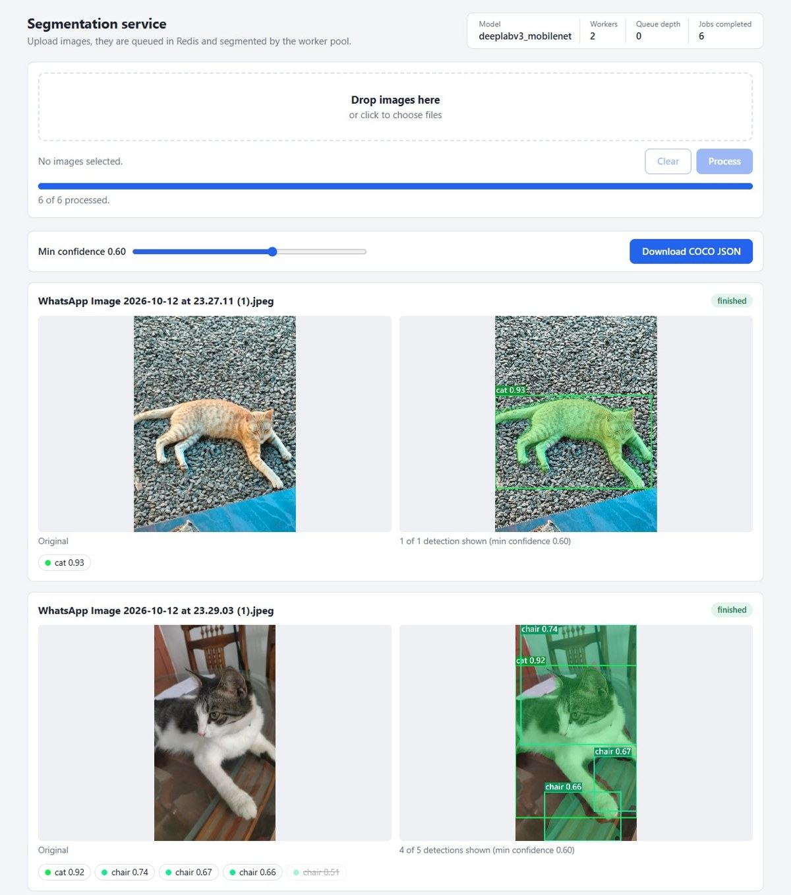
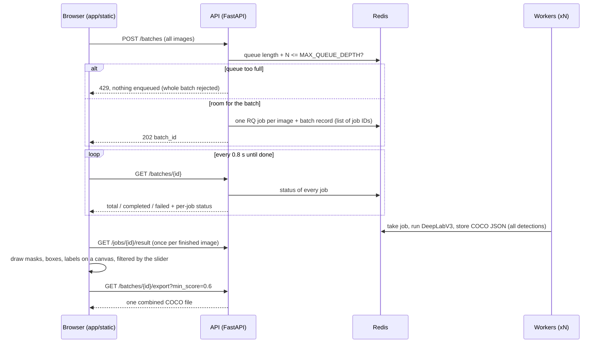
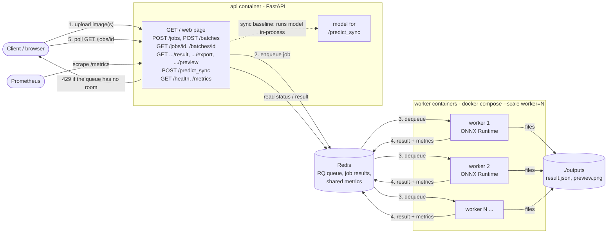
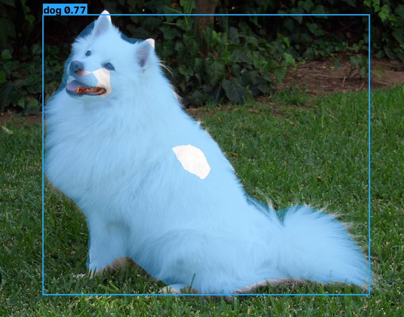

# scalable-inference-service

A small, queue-based image inference service: FastAPI in front, Redis + RQ as the job queue, and a pool of worker processes running ONNX models on the CPU. It includes a synchronous baseline endpoint, backpressure, Prometheus metrics, a Locust load test, and two pluggable models (MobileNetV2 classification and DeepLabV3 segmentation with bounding boxes + COCO output).

On top of that sits an end-to-end segmentation app: a web page where you drop in several images, watch them go through the queue, and look at the detected objects with a live confidence filter and a COCO export.

Built from scratch to learn what tools like Triton, KServe and BentoML handle for you.

## Quick start: the segmentation web app

You need Docker with Compose v2.

```bash
MODEL_NAME=deeplabv3_mobilenet docker compose up --build --scale worker=2
```

On Windows PowerShell:

```powershell
$env:MODEL_NAME = "deeplabv3_mobilenet"; docker compose up --build --scale worker=2
```

The first build takes a few minutes, because it downloads PyTorch to export the models. Then open **http://localhost:8000** and:

1. Drop images onto the page (or click to pick them) and press **Process**.
2. The progress bar fills as workers finish. Each image gets a card with the original on the left and the detected objects on the right.
3. Drag **Min confidence** to hide or show low-confidence detections. The boxes are redrawn in the browser, so no new request is needed.
4. **Download COCO JSON** saves one file for the whole batch, containing only the detections above the slider value.

The status panel in the top right shows the model, worker count, queue depth and jobs completed, read from `/metrics` every 2 seconds.



*Screenshot: five images processed by two DeepLabV3 workers. On the first image, two low-confidence "cat" detections (0.56 and 0.54) are crossed out because they are below the 0.60 slider value.*

### How it works



- **A batch is just a list of job IDs.** `POST /batches` validates every image first. One bad file rejects the batch with a 400 that names the file. It then checks that the *whole* batch fits under `MAX_QUEUE_DEPTH` and enqueues one ordinary RQ job per image in a single Redis round trip. The list of job IDs is stored under `batch:<id>` and expires together with the results. Workers don't know batches exist.
- **Workers keep every detection.** The COCO JSON stores every object with its score (anything bigger than 0.1% of the image). Only the server-side `preview.png` uses the `min_score=0.6` cut-off. This is what lets the slider work: the browser has all the data and decides what to show.
- **The browser draws, not the server.** The original image is shown straight from your disk (`URL.createObjectURL`), and the result is drawn on a `<canvas>` from the JSON: polygons for the mask, rectangles for the boxes, a tag with label and score. Moving the slider just redraws the canvases.
- **Export merges per-image files.** Each job's COCO JSON uses image id 1. `GET /batches/{id}/export` renumbers images and annotations so the ids are unique, uses your original file names, adds the `job_id` to each image, and applies `min_score` (`app/coco.py`).
- **Errors are shown, not swallowed.** A 429 shows the server's message ("N jobs waiting + M new would exceed the limit…") and keeps your selection so you can retry. Failed jobs get a red card with the worker's error (e.g. a truncated JPEG), and the progress bar shows how many failed.

The page is plain HTML, CSS and JavaScript (`app/static/`), with no framework and no build step. FastAPI serves it at `/`.

## Architecture



**Request flow (async path):**

1. `POST /jobs` validates the upload and checks the queue length. If `MAX_QUEUE_DEPTH` jobs are already waiting it returns **HTTP 429** with `Retry-After`. Otherwise it enqueues the job in Redis and returns a job ID straight away (HTTP 202).
2. A worker takes the job off the queue, runs `model.predict(image)`, writes `result.json` (plus `preview.png` for segmentation) to `outputs/<job_id>/`, and RQ stores the return value in Redis.
3. The client polls `GET /jobs/{id}` until `status` is `finished` (or `failed`).

**Sync baseline:** `POST /predict_sync` runs the same model inside the API process and returns the answer in the same HTTP request. No queue, no workers, and no backpressure.

### Endpoints

| Method and path | What it does |
|---|---|
| `GET /` | the web page |
| `POST /jobs` | one image (`file`) → `{job_id}`, or 429 when the queue is full |
| `GET /jobs/{id}` | status (`queued` / `started` / `finished` / `failed`), result and error |
| `GET /jobs/{id}/result?min_score=0` | only the model output (COCO JSON for segmentation), optionally filtered by score; 409 if not finished |
| `GET /jobs/{id}/preview` | `preview.png` with boxes drawn (segmentation only) |
| `POST /batches` | several images (`files`) → `{batch_id, job_ids}`; 429 if the whole batch doesn't fit, 400 if any file isn't an image |
| `GET /batches/{id}` | `total`, `completed`, `failed`, `pending`, `done` and per-job status/errors |
| `GET /batches/{id}/export?min_score=0` | one combined COCO JSON for the finished images of the batch (download) |
| `POST /predict_sync` | synchronous baseline, no queue |
| `GET /health`, `GET /metrics` | health check, Prometheus metrics |

Interactive API docs (generated by FastAPI) are at http://localhost:8000/docs.

### Project layout

```
app/
  api.py              FastAPI app (all endpoints, serves the web page)
  coco.py             COCO helpers: filter by score, merge per-image files into one
  worker.py           worker process: load model once, then process jobs forever
  tasks.py            the job function workers run (decode -> predict -> save outputs)
  metrics.py          Prometheus metrics stored in Redis so API + workers share them
  config.py           every setting, read from environment variables
  models/
    base.py           InferenceModel interface (one predict() method) + ONNX session helper
    classifier.py     MobileNetV2 (ImageNet classification)
    segmenter.py      DeepLabV3-MobileNetV3 -> objects, boxes, COCO JSON, preview image
    __init__.py       registry: MODEL_NAME -> class
  static/             the web page: index.html, style.css, app.js (no build step)
scripts/
  export_mobilenet.py export MobileNetV2 to ONNX (needs PyTorch)
  export_deeplab.py   export DeepLabV3 to ONNX (needs PyTorch)
  run_benchmarks.py   runs Locust against sync / 1 / 2 / 4 workers -> results/results.md
loadtest/
  locustfile.py       AsyncJobUser (submit + poll) and SyncUser
  sample.jpg          test image (the PyTorch Hub "dog.jpg")
tests/                pytest tests (fakeredis + fake model, no Docker needed)
docs/                 screenshots used in this README
```

### Some design decisions worth knowing about

- **Workers use RQ's `SimpleWorker`.** RQ's default worker forks a new process for every job. That would throw away the loaded model each time, and ONNX Runtime's thread pool isn't safe across `fork()`. `SimpleWorker` runs jobs in the same long-lived process, so the model is loaded once. To use more cores you run more worker containers.
- **One ONNX Runtime thread per worker** (`ORT_NUM_THREADS=1`). With N workers on one machine, letting each one grab every core would make them fight each other. With one thread each, `--scale worker=N` uses about N cores.
- **Metrics live in Redis.** A normal `prometheus_client.Counter` only exists in one process's memory, so a counter incremented in a worker would never appear on the API's `/metrics`. Workers increment counters and histogram buckets in Redis, and the API reads them at scrape time (`app/metrics.py`). Production setups use prometheus_client's multiprocess mode, a Pushgateway, or scrape each worker directly.
- **PyTorch is only used for export.** The Dockerfile has a throwaway `exporter` stage that installs PyTorch, downloads the pretrained weights and writes `.onnx` files. The runtime image only has `onnxruntime`.

## How to run (API only, classification model)

You need Docker (with Compose v2). Python is only needed for the tests and the load test. For the web app, see the [quick start](#quick-start-the-segmentation-web-app) above.

```bash
# Build (exports both models to ONNX inside Docker) and start 4 workers
docker compose up --build --scale worker=4

# Classify an image
curl -F file=@loadtest/sample.jpg http://localhost:8000/jobs
# -> {"job_id":"8b0c...","status":"queued"}
curl http://localhost:8000/jobs/8b0c...
# -> {"status":"finished","result":{"model":"mobilenet_v2","predictions":[{"label":"Samoyed","score":0.3975}, ...]}}

# Synchronous baseline
curl -F file=@loadtest/sample.jpg http://localhost:8000/predict_sync

curl http://localhost:8000/health
curl http://localhost:8000/metrics
```

### Segmentation model (bounding boxes + COCO JSON)

```bash
MODEL_NAME=deeplabv3_mobilenet docker compose up --build --scale worker=2
# (PowerShell: $env:MODEL_NAME="deeplabv3_mobilenet"; docker compose up --build --scale worker=2)

curl -F file=@loadtest/sample.jpg http://localhost:8000/jobs
curl http://localhost:8000/jobs/<job_id>/result                # COCO JSON, every detection
curl "http://localhost:8000/jobs/<job_id>/result?min_score=0.6" # only confident ones
curl -o preview.png http://localhost:8000/jobs/<job_id>/preview  # image with boxes drawn

# Several images at once
curl -F files=@a.jpg -F files=@b.jpg http://localhost:8000/batches   # -> {"batch_id": ...}
curl http://localhost:8000/batches/<batch_id>                        # progress
curl -o batch.coco.json "http://localhost:8000/batches/<batch_id>/export?min_score=0.6"
```

For every image the worker writes three files to `outputs/<job_id>/` (shared with your machine via a bind mount):

| File | Contents |
|---|---|
| `result.json` | COCO-style JSON: `images`, `categories`, and `annotations` with `bbox` `[x, y, w, h]`, polygon `segmentation`, `category_id`/`category_name`, `area`, and a confidence `score` |
| `preview.png` | the input image with a translucent mask, a box and a "label score" tag per object |
| `input.jpg` | a copy of the input, which the JSON's `file_name` refers to, so tools like CVAT or FiftyOne can open the pair |

Example `preview.png` for `loadtest/sample.jpg` (one `dog` object, mean confidence 0.77):



DeepLabV3 is a *semantic* segmentation model: it labels pixels, not instances. The worker turns the mask into objects by splitting each class into connected blobs with OpenCV (`cv2.connectedComponentsWithStats`). Each blob becomes one object with its box, its polygon (`cv2.findContours`), and a score equal to the mean per-pixel softmax confidence. Blobs smaller than 0.1% of the image are dropped as noise. Every other blob goes into the JSON with its score, but the preview image only draws objects with a score of at least `min_score=0.6`. (On the sample image the model labels two patches of white fur as "cat" with ~0.55 confidence. Those are the white holes in the mask above, and the crossed-out chips in the web app screenshot. The 0.6 was picked by eye, not tuned on a dataset.) The model only knows the 20 Pascal VOC classes (person, dog, cat, car, ...). It is much heavier than MobileNetV2: about 330–600 ms per image on one CPU thread, versus ~20 ms.

### Adding a new model

1. Subclass `InferenceModel` in `app/models/` and implement `predict(image) -> Prediction` (a JSON-serialisable `result` dict plus an optional `preview` image).
2. Add it to `MODEL_REGISTRY` in `app/models/__init__.py`.
3. Start the stack with `MODEL_NAME=<your key>`.

### Configuration

| Variable | Default | Meaning |
|---|---|---|
| `MODEL_NAME` | `mobilenet_v2` | `mobilenet_v2` or `deeplabv3_mobilenet` |
| `MAX_QUEUE_DEPTH` | `100` | waiting jobs before `POST /jobs` or `POST /batches` returns 429 |
| `ORT_NUM_THREADS` | `1` | ONNX Runtime threads per inference call (0 = all cores) |
| `API_WORKERS` | `1` | uvicorn processes in the api container |
| `RESULT_TTL_SECONDS` | `3600` | how long job results and batch records stay in Redis |
| `MAX_UPLOAD_BYTES` | `10485760` | images larger than this get 413 (per image, also in batches) |

### Metrics (`GET /metrics`)

`inference_queue_depth`, `inference_workers`, `inference_jobs_completed_total`, `inference_jobs_failed_total`, `inference_jobs_rejected_total`, and three latency histograms: `inference_job_latency_seconds` (enqueue → result, including queue wait), `inference_model_seconds` (time inside `predict`), and `inference_predict_sync_latency_seconds`.

### Tests and lint (no Docker needed)

```bash
python -m venv .venv && source .venv/bin/activate   # Windows: .venv\Scripts\activate
pip install -r requirements-dev.txt
pytest
ruff check . && ruff format --check .
```

The tests use `fakeredis` and a fake model, and they run RQ's `SimpleWorker` in burst mode, so the whole enqueue → worker → result path is tested without Redis or ONNX files. GitHub Actions runs the same steps on every push (`.github/workflows/ci.yml`).

To export the models locally instead of in Docker:

```bash
pip install torch==2.14.1 torchvision==0.29.1 --index-url https://download.pytorch.org/whl/cpu
pip install -r requirements-export.txt
python scripts/export_mobilenet.py && python scripts/export_deeplab.py   # -> models/
```

## Benchmark results

Run with `python scripts/run_benchmarks.py` (writes [`results/results.md`](results/results.md)). Setup: MobileNetV2, 16 concurrent Locust users with no think time, 60 s per scenario, on an **AMD Ryzen 5 7235HS: 4 physical / 8 logical CPU cores** (all 8 visible to Docker), Windows 11 + Docker Desktop.

| Scenario | Workers | Images completed | Throughput (images/s) | p50 latency (ms) | p95 latency (ms) | Failed | Rejected (429) |
|---|---|---|---|---|---|---|---|
| Sync baseline (/predict_sync) | - (in API process) | 4540 | 77.8 | 200 | 270 | 0 | 0 |
| Queue + 1 worker | 1 | 707 | 11.9 | 1300 | 1500 | 0 | 0 |
| Queue + 2 workers | 2 | 1207 | 20.7 | 770 | 890 | 0 | 0 |
| Queue + 4 workers | 4 | 1765 | 29.7 | 510 | 780 | 0 | 0 |

Queue latency is the full client round trip: upload + queue wait + inference + polling.

An earlier identical run gave 55.9 / 11.0 / 22.5 / 29.9 images/s. The queue numbers are stable between runs, but the sync baseline moved by ~40%, so treat single numbers with care.

### What the numbers say

- **Adding workers helps until the machine runs out of cores.** 1 → 2 workers almost doubles throughput (≈1.8×), but 2 → 4 only gives ≈1.4×. While the 4-worker test ran, `docker stats` showed each worker only ~60–80% busy, the API using 1–2 cores, and Redis plus Locust using the rest. Four single-threaded workers plus everything else need more than 4 physical cores, and two hyper-threads on one core don't give twice the work. A follow-up run with 4 uvicorn processes (`API_WORKERS=4`) checked whether the API was the bottleneck. It wasn't: throughput was 28.4 and 24.6 images/s in two runs (`results/results_api_workers_4.md`), slightly *worse*, because more processes just compete for the same cores.
- **One job costs much more than the model.** The model itself takes ~21 ms per image (`inference_model_seconds`), but a worker spends ~80 ms per job. About 39 ms goes to decoding the 1546×1213 JPEG, ~8 ms to writing `result.json` through Docker Desktop's bind mount, and the rest to RQ/Redis bookkeeping. With one worker the queue latency (~1.3 s) is mostly 16 users queueing behind a single worker.
- **The sync baseline wins on raw throughput on one machine, and that's expected.** FastAPI runs the sync endpoint in a thread pool, and ONNX Runtime releases Python's GIL, so 16 concurrent requests run the model on all 8 hardware threads at once, with no Redis, no polling and no result serialisation. The queue design isn't there to be faster on one box. It's there so that:
  - the API stays responsive while the slow work happens elsewhere
  - you can refuse work you can't handle (429) instead of letting latency grow without limit
  - workers can be scaled, restarted or moved to other (GPU) machines independently of the API
  - a crashing model doesn't take the web server down with it
  - jobs survive in Redis if a client disconnects

  The sync endpoint has no limit at all: with 200 users instead of 16, every request would simply get slower.

## Limitations (please read before trusting the numbers)

- **Everything here ran on one laptop.** The benchmark, the web app and all the testing were done locally on a single machine with Docker Desktop. Nothing has been deployed or tested across machines, on a real network, or with more than one user at a time.
- **Local, single-machine load test only.** Locust, the API, Redis and every worker ran on one laptop with 4 physical cores (8 threads), under Docker Desktop on Windows (a WSL2 VM). The load generator competes with the service for the same CPU, and traffic goes through Docker Desktop's port forwarding. Real deployments put the load generator, API and workers on separate machines. These numbers show *relative* behaviour (how scaling workers helps until the machine runs out of cores), not absolute capacity.
- **Short runs, one image.** Each scenario ran for 60 seconds with 16 concurrent users and the same JPEG every time. Across two runs the queue results were within ~10%, but the sync baseline varied from 56 to 78 images/s. Locust also rounds percentiles (e.g. to the nearest 10 ms above 100 ms).
- **Polling adds latency and load.** Async clients poll every 20 ms, which adds up to 20 ms of latency per job and hundreds of extra requests per second to the API. Production systems use long-polling, WebSockets, or callbacks/webhooks instead.
- **No model-level batching.** `POST /batches` is a convenience for clients: it still creates one job per image, and each worker runs one image at a time. Dynamic batching (grouping several images into one model call) is one of the biggest throughput wins that Triton and similar servers give you, and it isn't implemented here.
- **Backpressure is approximate.** The queue-depth check and the enqueue are two separate Redis calls, so under heavy concurrency the queue can overshoot `MAX_QUEUE_DEPTH` slightly.
- **No authentication, rate limiting per client, retries, or autoscaling.** Workers are scaled by hand with `--scale`. Failed jobs aren't retried. Anyone who can reach port 8000 and knows (or guesses) a job or batch ID can read its results.
- **Outputs are never cleaned up.** `outputs/` grows forever, and the images inside job payloads are stored in Redis until the result TTL expires.
- **Web app caveats.**
  - The whole batch is uploaded in one request, with no resumable uploads.
  - The page only remembers the current batch: reloading it loses the gallery (though the results stay in Redis for `RESULT_TTL_SECONDS`).
  - Progress comes from polling every 0.8 s, not push updates.
  - The batch export only includes images that finished; failed ones are left out.
  - The page was checked by hand-written Playwright runs in Microsoft Edge (Chromium) at laptop size. The CSS has a narrow-screen layout, but it was never tested. There are no automated browser tests in CI; the pytest suite only checks that the page and its assets are served.
- **Segmentation caveats.** The model input is a fixed 520×520 (images are stretched, not letterboxed). Touching objects of the same class merge into one box, polygons trace only the outer edge (holes aren't represented), and only the 20 VOC classes are detected. The benchmark above only covers MobileNetV2; you can benchmark segmentation with `MODEL_NAME=deeplabv3_mobilenet python scripts/run_benchmarks.py`, but expect roughly 20–30× lower throughput.

### Model limitations

The segmentation model is torchvision's pretrained DeepLabV3-MobileNetV3. It only predicts a fixed set of **21 categories**: the 20 PASCAL VOC classes plus background.

> aeroplane, bicycle, bird, boat, bottle, bus, car, cat, chair, cow, diningtable, dog, horse, motorbike, person, pottedplant, sheep, sofa, train, tvmonitor

Anything outside this list is either missed or given the name of the closest category it knows. A bounding box around an object therefore doesn't mean the label is right.

Things seen while trying the web UI by hand. These are observations on a few images, not a measured evaluation:

- **A photo of a hand was labelled "person".** The mask followed the hand, but "person" is just the closest known category.
- **Close-up photos of potato leaves gave no useful detections.** The only output was a low-confidence (0.40) "cat" guess, which the default slider threshold of 0.6 hides.
- **Screenshots can produce spurious "tvmonitor" detections.**

The `min_score=0.6` default used for the preview image (and as the slider's starting value) was chosen by looking at one image, as described above. It hasn't been tuned on any dataset.

The model is a pluggable class with a `predict()` method (see [Adding a new model](#adding-a-new-model)). A different model can be added without changing the queue, the API or the frontend, as long as it returns the same COCO-style JSON (`bbox`, `segmentation`, `category_name`, `score`) that the frontend draws from.

## Roadmap (planned, not implemented)

None of the following exists in this repository yet:

- **Open-vocabulary segmentation with text prompts**, for example with SAM 3, so you could ask for "potato leaf" or "hand" instead of being limited to the 21 VOC categories.
- **Optional VLM-assisted labelling**: a vision-language model suggesting or checking the label for each segmented region.
